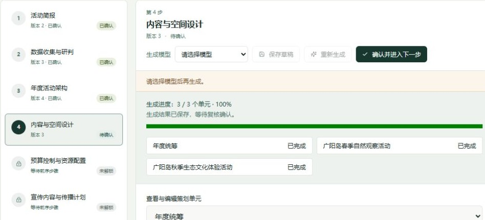
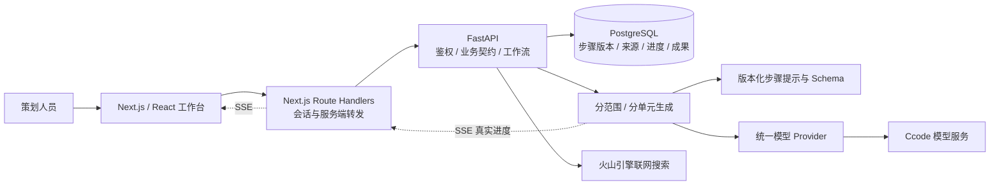

# 山河文旅 · AI 活动策划工作台

面向景区运营的全栈活动策划平台，将活动目标、公开资料研判、方案设计、预算、传播与执行准备组织成可编辑、可确认、可追溯的九步流程。支持**单场活动策划**与**年度总策划 + 多场活动简案 + 单场深入策划**两种工作方式。

当前已实现的核心是活动策划 Agent：真实模型调用、联网搜索、PostgreSQL 持久化、逐步确认与成果导出。平台中的其他专业 Agent、管理驾驶舱和部分运营页面仍是界面原型或预留接口，不能视为已完成的业务系统。

[核心能力](#核心能力) · [工程设计](#工程设计) · [本地运行](#本地运行) · [测试与验证](#测试与验证) · [代码导航](#代码导航)

## 核心能力

### 从单场活动到年度统筹

| 策划阶段 | 单场活动 | 年度总策划 |
| --- | --- | --- |
| 1. 活动简报 | 目标、时间、地点、客群、预算与约束 | 增加年度周期、年度目标及计划活动数量（2–12 场） |
| 2. 数据收集与研判 | 可选联网检索，保留来源和研判依据 | 根据年度目标开展研究，形成共享研判 |
| 3. 主题与架构 | 生成候选主题，选择并确认一个方向 | 确认年度叙事和全部活动简案，而非只选择一个主题 |
| 4–8. 方案展开 | 内容与空间、预算、传播、执行准备、渠道商业化 | 分别生成年度统筹与各场活动方案，可切换单元编辑 |
| 9. 预测与复盘 | 活动前预测、实际指标回填、复盘建议 | 年度统筹及各场活动分别复盘，保留年度整体报告 |

年度简案确认后，可以进入某场活动的独立策划任务；重复进入复用已有任务。年度来源版本变化时，系统明确提示冲突，避免使用已过期的简案继续生成。

### 全量来源，分范围归纳

- 联网搜索支持天气、节假日、同类活动、公共趋势四类范围，保存来源链接、抓取时间及检索摘要。
- 每个实际搜索范围独立请求模型，纳入该范围的全部检索证据，再按确定性规则合并研判结果。
- 页面同时展示主要发现、直接引用及全部检索来源。后续步骤使用已确认的研判，不继续携带全部原始检索正文。
- 来源区分实际数据、公开数据、参考测算与待补充项；测算保留依据，缺少依据的业务数字不自动补造。

### 可见进度与人工确认

研究归纳按搜索范围展示进度；年度规划按年度统筹、活动简案或各场方案展示进度。SSE 推送实际单元的等待、生成、完成、失败与取消状态，并显示已完成数量 / 总数量。刷新页面可读取持久化进度，不会自动再次发起模型请求。

生成完成后进入待确认状态。用户可以修改草稿、确认当前版本、退回修改和查看历史。前序内容变化会使相关后续结果进入待复核状态；服务端校验顺序和版本，防止绕过确认流程。

### 从方案到交付物

已实现活动方案 DOCX、预算 XLSX 与执行任务 XLSX 生成、版本保存和下载。执行准备步骤确认后创建待确认任务；对外发布、短信、广告投放及供应商询价仅生成草稿，当前不会自动调用外部执行系统。

### 界面预览

下图来自年度模式测试任务的真实界面，已裁去账户与任务页眉。年度统筹和两场活动分别完成生成后，用户可切换单元编辑并确认。



## 工程设计

### 系统架构



浏览器通过 Next.js 的 BFF 访问后端；数据库连接、模型密钥和搜索密钥只在服务端使用。当前模型 Provider 使用 Ccode，生成时必须从服务端白名单中显式选择模型，不自动切换供应商或返回模拟业务结果。

### 技术栈

| 层次 | 主要技术 |
| --- | --- |
| 前端 | Next.js 16、React 19、TypeScript、Tailwind CSS、Radix UI |
| 前端状态与请求 | TanStack Query、Zustand、Fetch / SSE |
| 后端 | Python、FastAPI、Pydantic、HTTPX、Uvicorn |
| 持久化 | PostgreSQL、SQLAlchemy 2、Alembic |
| 模型与研究 | 统一模型 Provider、版本化步骤 Skill、火山引擎搜索 |
| 验证 | ESLint、TypeScript、Python unittest、Node.js test runner |

### 关键工程问题

| 问题 | 当前实现 |
| --- | --- |
| 一次请求塞入全部资料，延迟高且上下文不断膨胀 | 研究按范围、年度方案按单元拆分模型请求；原始证据留存，后续仅引用已确认研判 |
| 进度条走完，但结果尚未保存或已经失败 | 状态来自服务端真实任务；只有收到保存成功的完成事件才视为生成成功 |
| 模型输出与业务结构不一致 | 前后端严格校验当前契约；未知字段、缺失字段和错误结构明确失败 |
| 修改上游内容后，下游仍被当作有效方案 | 步骤版本、确认记录、下游失效标记与历史输出分开管理 |
| 多端修改或重复请求造成覆盖、重复任务 | 服务端所有权校验、乐观锁、事务与幂等边界 |
| 年度预算与各场预算相加出现误差 | 预算合计由程序确定性计算，前端使用十进制乘加并校验年度总额 |
| 会话与服务凭据暴露到浏览器 | HttpOnly 会话 Cookie、服务端转发；密码使用 scrypt，会话令牌以哈希保存 |

这些约束同时用于单场与年度模式。测试可以显式注入 Fake Provider，生产路径不会因为模型失败而返回演示结果。

## 本地运行

### 运行条件

- 推荐 Node.js 24 LTS、npm、Python 3.12。
- 本地 PostgreSQL 服务，以及可创建应用数据库的账户。
- 有效的 Ccode API Key 和可用模型 ID；开启联网研究时还需火山引擎搜索 API Key。
- 模型与搜索均为外部服务，需自行申请凭据，调用可能产生费用。仓库不附带账户、私有业务数据库或真实密钥。

### 首次配置

**1. 获取代码并安装前端依赖**

```bash
git clone https://github.com/hyxhyxhhh/shanhe-cultural-tourism-ai.git
cd shanhe-cultural-tourism-ai
npm ci
```

**2. 创建 Python 虚拟环境并安装后端依赖**

Windows PowerShell：

```powershell
python -m venv .venv
.\.venv\Scripts\python.exe -m pip install -r backend/requirements.txt
Copy-Item .env.example .env.local
```

macOS / Linux：

```bash
python3 -m venv .venv
.venv/bin/python -m pip install -r backend/requirements.txt
cp .env.example .env.local
```

**3. 配置数据库和服务凭据**

在 PostgreSQL 中创建专用角色与数据库，例如在管理员 `psql` 会话中执行：

```sql
CREATE ROLE shanhe_app LOGIN;
\password shanhe_app
CREATE DATABASE shanhe OWNER shanhe_app;
```

编辑项目根目录 `.env.local`。保留 `.env.example` 中的完整配置项，替换占位值：

| 环境变量 | 用途 |
| --- | --- |
| `DATABASE_URL` | `postgresql+psycopg://shanhe_app:<你的密码>@127.0.0.1:5432/shanhe`；密码中的特殊字符需 URL 编码 |
| `FASTAPI_BASE_URL` | 一键启动使用 `http://127.0.0.1:8000` |
| `CCODE_API_BASE_URL` / `CCODE_API_KEY` | 当前模型 Provider 的服务地址与密钥 |
| `CCODE_ALLOWED_MODELS` | 真实可用的模型 ID，逗号分隔，不含空格；不是默认模型 |
| `VOLCENGINE_SEARCH_API_KEY` | 开启联网研究时使用的搜索密钥 |
| 超时、输出上限等其他字段 | 参照 `.env.example`，按服务额度与任务需求配置 |

`.env.local` 已被 Git 忽略。模型与搜索密钥不能改为 `NEXT_PUBLIC_*` 环境变量。数据库迁移是共享 schema 的唯一来源，不能用自动建表代替迁移。

**4. 一键启动**

```bash
npm run dev:all
```

命令检查环境、Python 依赖与端口，执行 `alembic upgrade head`，随后在同一终端启动 FastAPI（8000）和 Next.js（3001）。优先使用项目 `.venv`；需要指定其他 Python 时设置 `SHANHE_PYTHON`。按 `Ctrl+C` 停止本次启动的服务。

**5. 创建本地登录账户**

在另一个终端进入项目根目录，执行以下命令，并按提示输入至少 16 字符的密码；密码不会出现在命令参数中。

Windows PowerShell：

```powershell
.\.venv\Scripts\python.exe -m backend.create_user --account planner --display-name "本地策划员" --role-id platform-admin
```

macOS / Linux：

```bash
.venv/bin/python -m backend.create_user --account planner --display-name "本地策划员" --role-id platform-admin
```

打开 [活动策划工作台](http://127.0.0.1:3001/event-agent)，使用新建账户登录，创建任务并选择单场或年度模式。后端接口文档位于 [FastAPI /docs](http://127.0.0.1:8000/docs)。

### 后续启动

完成首次配置后，在项目根目录只需执行：

```bash
npm run dev:all
```

仅检查启动条件、不迁移数据库或启动服务：

```bash
npm run dev:all -- --check
```

端口已占用或配置有误时会明确报错，不会自动终止已有服务、换端口或替换模型。更完整的数据库说明见 [PostgreSQL 开发配置](docs/postgresql-development.md)。

## 测试与验证

在已配置 `.env.local` 且安装依赖的项目根目录执行前端检查：

```bash
npm run lint
npm run typecheck
npm run build
node --test lib/api/*.test.mjs lib/*.test.mjs lib/platform/*.test.mjs
```

后端测试使用标准库 `unittest`。先安装开发依赖，再运行完整测试发现：

```powershell
.\.venv\Scripts\python.exe -m pip install -r backend/requirements-dev.txt
.\.venv\Scripts\python.exe -m unittest discover -s . -p "test_*.py"
```

macOS / Linux 将上述 Python 路径替换为 `.venv/bin/python`。测试覆盖生成契约、鉴权、步骤确认、并发与版本冲突、全量研究证据、分组生成进度、年度预算、子活动关联及成果文件等。模型单元测试使用显式注入的测试 Provider，不代表真实模型的内容质量验收。

本地联调还可检查 `/health` 和 `/health/database`，并用测试任务验证“生成 → 编辑 → 确认 → 修改前序 → 下游复核”的流程。真实模型与搜索联调需要自己的有效凭据。

## 代码导航

```text
app/                       Next.js 页面与 BFF API 路由
components/activity/       活动工作台、步骤编辑、执行任务与成果界面
lib/api/                   前端请求、严格业务契约与 SSE 解析
lib/server/                FastAPI 服务端转发与会话边界
backend/activity_steps.py  九步状态机、输出校验与版本行为
backend/research_generation.py  按搜索范围生成与持久化进度
backend/planning_generation.py  单场 / 年度分单元生成
backend/annual_activity_api.py  年度简案进入独立活动
backend/activity_skills/   版本化步骤规则与提示文档
backend/app/               研究、执行任务、模型适配与成果服务
backend/migrations/        Alembic 数据库迁移
scripts/dev-all.mjs        本地启动检查、迁移与进程管理
docs/                     业务契约与开发说明
```

进一步阅读：

- [活动策划业务契约](docs/activity-agent-contract.md)
- [单场与年度规划契约](docs/planning-v1-contract.md)
- [统一模型 Provider 契约](docs/unified-provider-interface.md)

## 项目边界与开发方式

当前重点是活动策划的完整纵向流程。其他 Agent 的通用执行接口、部分驾驶舱指标及平台级运营能力仍为占位；微信登录、自动对外执行等入口不代表已接入生产服务。生成内容需要策划人员核验，公开检索资料也不替代景区真实经营数据。

项目属于团队持续迭代的文旅平台，本仓库公开展示当前代码快照。开发采用人工确认业务规则、AI 辅助开发的协作方式，使用 Codex 辅助编码与排错，并通过代码 review、契约校验、自动化测试和真实任务联调验证修改。这里展示实际实现及工程约束，商业效果与生产规模尚未验证。

代码及展示素材的独立授权条款尚未声明；公开可见不等于附带开源许可。页面中的示例项目名称与测试任务仅用于功能演示，不代表商业合作或背书。
